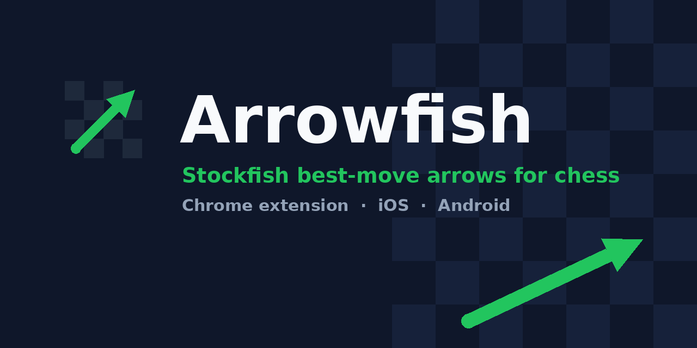

<p align="center"></p>

# Arrowfish for desktop

A Chrome extension that runs **Stockfish** locally in your browser and draws **arrows over the board** on [Lichess](https://lichess.org) and [Chess.com](https://chess.com) to show the best moves.

- Green arrow = best move, blue/orange = 2nd/3rd best (up to 3 lines)
- Engine runs on your machine (WebAssembly) - nothing is sent anywhere
- Works with either board orientation; detects whose turn it is from the last-move highlight
- Alt+A toggles the arrows; popup sets depth (6-22) and number of lines


## Install (3 steps)

```bash
git clone https://github.com/<you>/Arrowfish-desktop.git
cd Arrowfish-desktop
node scripts/setup.mjs      # downloads Stockfish into ./engine (needs Node 18+ and npm)
```

Then open `chrome://extensions`, enable **Developer mode**, click **Load unpacked** and pick this folder. Full details in [MANUAL.md](MANUAL.md).

Phone version: [Arrowfish-phone](../Arrowfish-phone).

## How it works

`content.js` reads the board from the page, builds a FEN, and asks `background.js`, which forwards to an offscreen document (`offscreen.js`) that hosts the Stockfish WebAssembly worker. Results come back as UCI moves and are drawn as an SVG overlay.

## License

MIT for Arrowfish code. Stockfish is GPLv3 and is downloaded separately.
